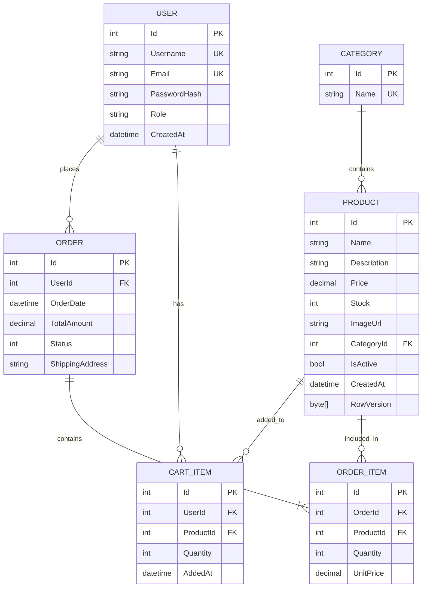

# Online Store Web API

[](https://github.com/YYMASUD/aspnetcore-online-store-api/actions/workflows/ci.yml)
[](https://dotnet.microsoft.com/)
[](LICENSE)

A production-ready Online Store REST API built with ASP.NET Core 8, featuring JWT authentication, role-based access control, shopping cart management, order processing, and comprehensive search/filtering capabilities.

## Features

- **Authentication & Authorization**: JWT Bearer tokens with role-based access (Admin, Customer)
- **Product Catalog**: Search, filter by category/price, sort (price_asc, price_desc, name, newest), pagination
- **Shopping Cart**: Add/remove items, quantity management, stock validation
- **Order Management**: Transactional checkout, status transitions, cancellation with stock restoration
- **Optimistic Concurrency**: RowVersion prevents overselling in high-traffic scenarios
- **Clean Architecture**: Separation of concerns with Domain, Application, Infrastructure, and API layers
- **Comprehensive Validation**: FluentValidation for all request DTOs
- **Error Handling**: RFC 7807 ProblemDetails responses
- **Logging**: Serilog with console and file sinks
- **Documentation**: Swagger UI with JWT Authorize button
- **Docker Support**: Multi-stage build with SQL Server in docker-compose
- **CI/CD**: GitHub Actions workflow with build, test, and Docker validation

## Architecture

```
┌─────────────────────────────────────────────────────────────┐
│                        API Layer                             │
│  (Controllers, Middleware, Program.cs)                       │
└────────────────────────┬────────────────────────────────────┘
                         │
┌────────────────────────▼────────────────────────────────────┐
│                   Application Layer                          │
│  (DTOs, Services, Validators, Interfaces)                    │
└────────────────────────┬────────────────────────────────────┘
                         │
┌────────────────────────▼────────────────────────────────────┐
│                  Infrastructure Layer                        │
│  (EF Core, Repositories, Identity, External Services)        │
└────────────────────────┬────────────────────────────────────┘
                         │
┌────────────────────────▼────────────────────────────────────┐
│                     Domain Layer                             │
│  (Entities, Enums, Domain Rules, Exceptions)                 │
└─────────────────────────────────────────────────────────────┘
```

## Project Structure

```
aspnetcore-online-store-api/
├── src/
│   ├── StoreApi.Domain/              # Entities, enums, domain rules
│   ├── StoreApi.Application/         # DTOs, services, validators
│   ├── StoreApi.Infrastructure/      # EF Core, repositories, identity
│   └── StoreApi.Api/                 # Controllers, middleware, config
├── tests/
│   ├── StoreApi.UnitTests/           # Unit tests
│   └── StoreApi.IntegrationTests/    # Integration tests
├── .github/workflows/ci.yml          # GitHub Actions CI
├── docker-compose.yml                # Docker orchestration
├── Dockerfile                        # Multi-stage build
└── README.md
```

## Database Diagram



## Prerequisites

- [.NET 8 SDK](https://dotnet.microsoft.com/download/dotnet/8.0)
- [SQL Server](https://www.microsoft.com/sql-server/sql-server-downloads) (local or Docker)
- [Docker](https://www.docker.com/get-started) (optional, for containerized deployment)

## Setup

### Local Development

1. **Clone the repository:**
   ```bash
   git clone https://github.com/YYMASUD/aspnetcore-online-store-api.git
   cd aspnetcore-online-store-api
   ```

2. **Configure user secrets:**
   ```bash
   cd src/StoreApi.Api
   dotnet user-secrets init
   dotnet user-secrets set "ConnectionStrings:DefaultConnection" "Server=localhost;Database=StoreApiDb;User Id=sa;Password=YourPassword123;TrustServerCertificate=True"
   dotnet user-secrets set "Jwt:Key" "your-secret-key-must-be-at-least-32-bytes-long"
   dotnet user-secrets set "Jwt:Issuer" "StoreApi"
   dotnet user-secrets set "Jwt:Audience" "StoreApi.Clients"
   dotnet user-secrets set "Admin:Email" "admin@storeapi.local"
   dotnet user-secrets set "Admin:Password" "Admin#Passw0rd"
   ```

3. **Run migrations:**
   ```bash
   cd ../..
   dotnet ef database update --project src/StoreApi.Infrastructure --startup-project src/StoreApi.Api
   ```

4. **Run the API:**
   ```bash
   dotnet run --project src/StoreApi.Api
   ```

5. **Access Swagger UI:**
   Open https://localhost:5001/swagger in your browser.

### Docker

1. **Copy `.env.example` to `.env` and configure:**
   ```bash
   cp .env.example .env
   # Edit .env with your values
   ```

2. **Start services:**
   ```bash
   docker compose up -d
   ```

3. **Access the API:**
   - Swagger UI: http://localhost:5000/swagger
   - Health check: http://localhost:5000/health

## Default Admin Credentials

The API creates a default admin account on first startup:

- **Email:** admin@storeapi.local (configurable via `Admin:Email`)
- **Password:** Admin#Passw0rd (configurable via `Admin:Password`)

**⚠️ Important:** Change these credentials in production environments!

## API Endpoints

### Authentication

| Method | Endpoint | Access | Description |
|--------|----------|--------|-------------|
| POST | /api/auth/register | Public | Register customer account |
| POST | /api/auth/login | Public | Login and get JWT token |

### Categories

| Method | Endpoint | Access | Description |
|--------|----------|--------|-------------|
| GET | /api/categories | Public | List all categories |
| POST | /api/categories | Admin | Create category |
| PUT | /api/categories/{id} | Admin | Update category |
| DELETE | /api/categories/{id} | Admin | Delete category (blocked if has products) |

### Products

| Method | Endpoint | Access | Description |
|--------|----------|--------|-------------|
| GET | /api/products | Public | Search, filter, sort, paginate |
| GET | /api/products/{id} | Public | Get product details |
| POST | /api/products | Admin | Create product |
| PUT | /api/products/{id} | Admin | Update product |
| DELETE | /api/products/{id} | Admin | Soft delete (IsActive = false) |

### Shopping Cart

| Method | Endpoint | Access | Description |
|--------|----------|--------|-------------|
| GET | /api/cart | Customer | View cart with totals |
| POST | /api/cart | Customer | Add item (merge if exists) |
| PUT | /api/cart/{itemId} | Customer | Change quantity |
| DELETE | /api/cart/{itemId} | Customer | Remove item |
| DELETE | /api/cart | Customer | Clear cart |

### Orders

| Method | Endpoint | Access | Description |
|--------|----------|--------|-------------|
| POST | /api/orders/checkout | Customer | Create order from cart |
| GET | /api/orders/my | Customer | My orders |
| GET | /api/orders/{id} | Owner/Admin | Order details |
| GET | /api/orders | Admin | All orders (paginated) |
| PUT | /api/orders/{id}/status | Admin | Update status |
| PUT | /api/orders/{id}/cancel | Owner | Cancel order (Pending only) |

## Example Requests

### Register

```bash
curl -X POST http://localhost:5000/api/auth/register \
  -H "Content-Type: application/json" \
  -d '{
    "username": "alice",
    "email": "alice@example.com",
    "password": "Password123!"
  }'
```

**Response (201):**
```json
{
  "token": "eyJhbGciOiJIUzI1NiIsInR5cCI6IkpXVCJ9...",
  "username": "alice",
  "role": "Customer",
  "expiresAt": "2026-11-23T15:30:00Z"
}
```

### Login

```bash
curl -X POST http://localhost:5000/api/auth/login \
  -H "Content-Type: application/json" \
  -d '{
    "email": "alice@example.com",
    "password": "Password123!"
  }'
```

### Add to Cart

```bash
curl -X POST http://localhost:5000/api/cart \
  -H "Content-Type: application/json" \
  -H "Authorization: Bearer YOUR_TOKEN" \
  -d '{
    "productId": 1,
    "quantity": 2
  }'
```

### Checkout

```bash
curl -X POST http://localhost:5000/api/orders/checkout \
  -H "Content-Type: application/json" \
  -H "Authorization: Bearer YOUR_TOKEN" \
  -d '{
    "shippingAddress": "123 Main St, City, Country"
  }'
```

## Running Tests

```bash
dotnet test
```

- **27 unit tests** covering validators, domain logic, and business rules
- **15 integration tests** covering auth, catalog, cart, and order endpoints

## Future Improvements

- **Payment Integration**: Stripe or PayPal for real payment processing
- **Refresh Tokens**: Extend authentication with refresh token rotation
- **Product Reviews**: Allow customers to rate and review products
- **Redis Caching**: Cache product listings and search results
- **Image Upload**: Azure Blob Storage for product images
- **Email Notifications**: Order confirmations and shipping updates
- **Search Enhancement**: Elasticsearch for full-text search
- **Audit Logging**: Track all admin actions

## License

This project is licensed under the MIT License - see the [LICENSE](LICENSE) file for details.

## Contributing

Contributions are welcome! Please follow these steps:

1. Fork the repository
2. Create a feature branch (`git checkout -b feature/amazing-feature`)
3. Commit your changes using [Conventional Commits](https://www.conventionalcommits.org/) (`git commit -m 'feat: add amazing feature'`)
4. Push to the branch (`git push origin feature/amazing-feature`)
5. Open a Pull Request

## Support

For issues and questions, please [open an issue](https://github.com/YYMASUD/aspnetcore-online-store-api/issues).
